# Lumens Deep User Guide & Manual

Welcome to **Lumens Deep**, a next-generation, non-destructive 32-bit floating-point RAW photo editor and AI-powered 3D relighting suite.

---

## 1. Getting Started

### 1.1. System Requirements & Installation
- **Operating System**: Windows 10/11 (64-bit), macOS 12+, or modern Linux distribution.
- **GPU for AI & Rendering**:
  - **NVIDIA GPU Acceleration (Recommended)**: NVIDIA GeForce RTX / GTX series (CUDA 12.1+ / 12.6+ / 12.8 driver).
  - **AMD / Intel GPU Acceleration**: DirectX 12 / DirectML compatible GPU.
  - **Apple Silicon**: M1/M2/M3/M4 via CoreML / Metal.
  - **Rendering**: Dedicated or integrated GPU supporting OpenGL 3.3+ (ModernGL).
- **Python**: Python 3.10, 3.11, 3.12, or 3.14+.

#### Step 1: Install Python Dependencies
```bash
# 1. Base dependencies
pip install -r requirements.txt
```

#### Step 2: Enable GPU Hardware Acceleration for AI
To unlock maximum speed (~12x faster depth map generation on GPU):

- **For NVIDIA GPUs (CUDA 12.6 Acceleration)**:
  ```bash
  pip install torch torchvision --index-url https://download.pytorch.org/whl/cu126 --upgrade
  ```
- **For AMD / Intel / Any Windows GPU (DirectX 12 DirectML Acceleration)**:
  ```bash
  pip install onnxruntime-directml
  ```
- **For CPU Only (Safe Fallback)**:
  No extra installation needed; Lumens Deep automatically uses optimized multi-threaded CPU execution if no GPU backend is found.

#### Step 3: Launch Lumens Deep
```bash
python src/gui/main_window.py
```

### 1.2. Workspace Overview
The workspace is organized into intuitive, high-productivity dock panels:

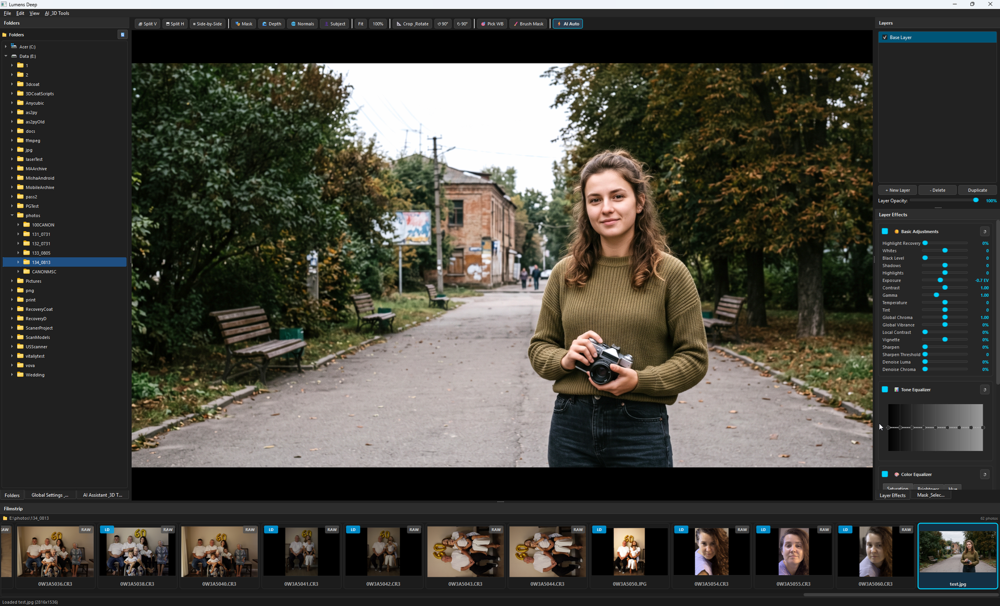

```
┌─────────────────┬───────────────────────────────────────────┬─────────────────┐
│  LEFT PANELS    │              CENTRAL VIEWPORT             │  RIGHT PANELS   │
│  [Folders]      │  [ Top Toolbar: Zoom / Crop / Compare ]   │  [Layers]       │
│  [Global & 3D]  │  ───────────────────────────────────────  │  [Layer Effects]│
│  [AI Assistant] │             Interactive Canvas            │  [Masks]        │
├─────────────────┴───────────────────────────────────────────┴─────────────────┤
│                        BOTTOM PANEL: FILMSTRIP DOCK                           │
└───────────────────────────────────────────────────────────────────────────────┘
```

- **Left Panels**:
  - **Folders**: Browse directories and subfolders.
  - **Global Settings**: Lensfun distortion profiles, 3D Bokeh simulation, and global base curve output.
  - **AI Assistant**: Compute neural depth maps, high-frequency surface normals, and subject alpha masks.
- **Central Viewport**: High-DPI canvas with GPU zoom, pan, interactive crop/straighten HUD, split before/after wipe, and brush painting.
- **Right Panels**:
  - **Layers**: Non-destructive layer stack (add, duplicate, delete, reorder, adjust opacity).
  - **Layer Effects**: Active layer adjustment plugins (Basic Adjustments, Tone Equalizer, Color Equalizer, Shadow Color Equalizer).
  - **Masks**: Precision masking tools (Parametric OKLCH Color/Luma, Linear/Radial Gradients, 3D Depth/Normals, Painted Brush Mask).
- **Bottom Panel (Filmstrip)**: Async multi-threaded thumbnail browser with caching and instant image switching.

---

## 2. Working with Images & RAW Files

### 2.1. Supported File Formats & Hardware-Filtered RAW Anti-Aliasing
Lumens Deep supports all major camera RAW formats and standard image formats via `rawpy` and `imageio`:
- **RAW Sensor Formats**: Canon (`.CR3`, `.CR2`), Nikon (`.NEF`), Sony (`.ARW`), Fujifilm (`.RAF`), Panasonic/Leica (`.RW2`), Adobe Digital Negative (`.DNG`).
- **Standard Image Formats**: `.TIFF`, `.PNG`, `.JPG`, `.JPEG`, `.WEBP`, `.EXR`.
- **Trilinear Hardware Mipmap Pyramids (`GL_LINEAR_MIPMAP_LINEAR`)**:
  - High-resolution 45-megapixel RAW sensors (e.g. 8192×5464 Canon CR3) are processed with automatic GPU mipmap generation (`build_mipmaps()`).
  - When scaled down for viewport inspection, the GPU automatically samples the pre-filtered level of detail (LOD), completely eliminating sensel aliasing, moiré patterns, and high-frequency shimmering noise.

### 2.2. Folder Navigation, Resizable Filmstrip & Rating
1. In the **Folders** dock on the left, navigate and click any folder containing images.
2. The bottom **Filmstrip** dock asynchronously scans files, EXIF orientation metadata, and existing 3D depth maps.
3. **Filmstrip Features**:
   - **Resizable Filmstrip Height**: Drag the top divider handle or use the height slider to expand thumbnail cards from $100\text{px}$ up to $360\text{px}$.
   - **3D Depth Badges**:
     - **`✓ 3D` (Cyan/Teal Pill Badge with Checkmark)**: A physical 16-bit high-resolution depth map is generated and saved in `{folder}/LumenDeep/`, ready for instant 3D Bokeh and 3D depth-masked grading.
     - **`🧊 +3D` (Amber/Gold Outline Badge)**: Photo is marked by AI or user as requiring 3D depth map generation (pending calculation).
   - **Star Ratings & Reject Flags**:
     - Press `1` – `5` on the keyboard to set star rating.
     - Press `X` to mark for deletion (`❌`).
     - Press `0` to clear rating.
   - **Quick Filtering Toolbar**: Filter visible photos by rating (e.g. `★ 5`, `★ 4+`), hide rejected photos, or display only photos with 3D depth (`🧊 Depth Only`).
   - **Local LumenDeep Storage**: All project sidecars (`.lumendeep`), depth maps (`_depth.png`), normal maps (`_normals.png`), and subject masks (`_subject.png`) are stored in the clean `{folder}/LumenDeep/` subfolder.

### 2.3. ⚡ Fast Viewer Mode & Sub-50ms Instant Natural Previews
- **Fast Viewer Mode (`V`)**: Press `V` or click the lightning bolt icon on the top toolbar to activate instant browsing mode.
  - Pauses full 32-bit RAW demosaicing for ultra-fast browsing (<50ms per photo).
  - Uses hardware libjpeg draft scale-on-decode and vectorized 256-LUT sRGB mapping.
  - Automatically persists camera preview JPEGs to `{folder}/LumenDeep/{stem}_half.jpg` for 0ms future switching.
- **Instant Natural Preview**: From the exact millisecond a photo is clicked in the Filmstrip, Lumens Deep displays an instant neutral preview with 100% natural camera exposure and color tones while 32-bit RAW sensor data decodes in the background.
- **Dirty State Tracking & Save Confirmation**:
  - Lumens Deep strictly tracks manual adjustments (`_is_dirty`).
  - Browsing photos or viewing in Fast Viewer mode **never overwrites** `.lumendeep` project sidecars.
  - When switching photos or closing the app after manual changes, a clear prompt asks whether to **Save**, **Discard**, or **Cancel**.

---

## 3. Viewport & Canvas Navigation

### 3.1. Pan & Zoom
- **Zoom**: Scroll the **Mouse Wheel** up/down, or use `Ctrl + +` / `Ctrl + -`.
- **Pan**: Hold **Left Click and Drag** (when brush tool is inactive) or **Middle Mouse Drag**.
- **Fit View**: Click `Fit View` on the toolbar or press `Ctrl + 0`.
- **100% (1:1 Pixel) View**: Click `1:1 View` on the toolbar or press `Ctrl + 1`.

### 3.2. 📐 Interactive Crop, Straighten & Standard Aspect Ratios
Click the **`📐 Crop & Rotate`** toolbar button or press **`C`** to activate the canvas crop tool:
1. **Interactive Handles**: Drag any of the 8 white corner brackets or midpoint tabs on the image to reframe the crop.
2. **Aspect Ratio Constraints**: Choose a standard aspect ratio constraint from the dropdown menu (in the toolbar or Global dock):
   - **`Free (Custom)`**: Unconstrained cropping.
   - **`Original (Sensor)`**: Preserves the original sensor aspect ratio.
   - **`1:1 (Square / Instagram)`**: 1:1 square format for Instagram posts and profile avatars.
   - **`4:5 / 5:4 (Instagram / 8×10")`**: Instagram portrait feed posts & standard $8\times 10\text{"}$ photo paper.
   - **`3:4 / 4:3 (Photo 6×8" / iPad)`**: Standard $6\times 8\text{"}$ print paper and iPad screens.
   - **`2:3 / 3:2 (35mm / 4×6" / 10×15cm)`**: Classic 35mm DSLR sensor ratio & standard $4\times 6\text{"}$ ($10\times 15\text{ cm}$) photo paper.
   - **`9:16 / 16:9 (Stories / Reels / TV)`**: Instagram Stories, Reels, TikTok & widescreen monitors.
   - **`3.5:4.5 / 4.5:3.5 (Passport / ID)`**: International biometric passport & ID photo dimensions ($35\times 45\text{ mm}$).
   - **`5:7 / 7:5` & `11:14 / 14:11`**: Standard print frame sizes ($13\times 18\text{ cm}$, $28\times 35\text{ cm}$).
3. **`🔄 Swap (Landscape ↔ Portrait)`**: Instantly flip aspect ratio orientation (e.g., $4:5 \leftrightarrow 5:4$, $2:3 \leftrightarrow 3:2$).
4. **Interactive Straighten**:
   - Hover slightly outside the corner brackets (cursor changes to a curved rotation arrow) and drag to rotate the crop angle interactively.
   - Alternatively, adjust the **`Straighten`** slider in the Global dock.
5. **Floating HUD Badge**: Displays the active aspect ratio preset and straighten angle live above the crop box. Press **`Enter`** or **`C`** to apply.

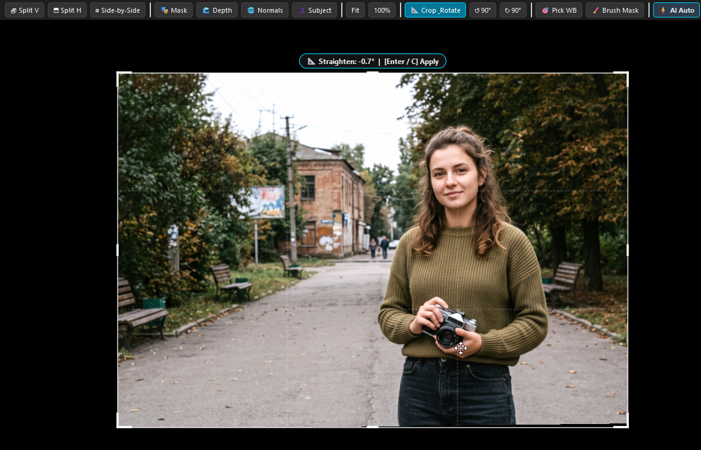

### 3.3. ⚡ Instant Preview & Three-Tier Streaming (`_preview.jpg`, `_rhalf.jpg`, `_half.jpg`)
Lumens Deep uses a three-tier instant streaming preview pipeline for lightning-fast responsiveness when browsing photos:
1. **Tier 1: `_preview.jpg` (Rendered Viewport Composite Snapshot)**:
   - When returning to a photo that has already been developed and adjusted, `LumenDeep/{stem}_preview.jpg` loads **instantly in 0 ms**.
   - Contains the exact finished composite image cropped from the Viewport (with all 3D maps, bokeh, layers, and color grades baked).
2. **Tier 2: `_rhalf.jpg` (Exact RAW Sensor Linear Preview)**:
   - If `_preview.jpg` does not exist yet, `LumenDeep/{stem}_rhalf.jpg` loads with **0 ms latency**.
   - Contains uncurved 50% sensor linear data, allowing all user sliders and tone equalizers to render live with 100% full precision.
   - **Seamless Edit Preservation**: Any adjustments you make to sliders (exposure, contrast, tone curves, bokeh) while `_rhalf.jpg` is visible are **100% preserved and carried over** when the full 32-bit RAW finishing demosaicing in the background.
3. **Tier 3: `_half.jpg` (In-Camera JPEG Passthrough Fallback)**:
   - If no cache exists yet, the in-camera JPEG preview `_half.jpg` (or extracted embedded thumbnail) is displayed in **clean neutral passthrough mode** (without any double-exposure or double-curves), presenting the photo exactly as shot.
   - In the background, `ImageLoaderThread` demosaics the full 32-bit RAW sensor data and decodes high-resolution 3D maps (`_depth.png`, `_normals.png`, `_subject.png`) asynchronously without freezing the UI thread.
   - Once background decoding finishes, GPU textures update seamlessly.

### 3.4. ⚡ Fast Viewer Mode (`V`)
For ultra-fast culling and rapid reviewing through hundreds of high-resolution RAW files:
- **Toggle Fast Viewer Mode**: Click the **`⚡ Fast Viewer`** button on the toolbar or press **`V`** (also available in **View → Fast Viewer Mode**).
- **Behavior in Viewer Mode**:
  - Only fast JPEGs (`_preview.jpg`, `_rhalf.jpg`, `_half.jpg` or embedded camera previews) are loaded in **< 15 ms**.
  - **RAW sensor demosaicing is completely paused** to conserve 100% CPU and GPU power and eliminate all background decoding delays.
  - Editing docks are dimmed to prevent accidental slider changes during high-speed photo review.
- **Switching to Edit Mode**:
  - Simply turn off **`⚡ Fast Viewer`** (or press **`V`**). Lumens Deep will immediately load the full 32-bit RAW sensor data and 3D maps for the active photo and restore all editing controls!

### 3.5. Before / After & Split Comparison Modes
Compare adjustments against the unprocessed RAW image:
- **`👁 Before Mode` (`\`)**: Press and hold or toggle to view the original untouched image.
- **`◧ Vertical Split`**: Left side shows original image, right side shows processed output. Drag the white divider line horizontally across the canvas.
- **`⬓ Horizontal Split`**: Top side shows original image, bottom side shows processed output. Drag the divider line vertically.
- **`◫ Side-by-Side`**: Dual view showing Before and After in split halves.

### 3.6. 📐 Interactive Crop, Straighten HUD & Aspect Ratio Presets
- **Aspect Ratio Selector**: Quickly enforce standard framing presets across your photos from the top quick-access toolbar, Global dock, or Filmstrip:
  - `Free` (Unconstrained manual framing)
  - `Original` (Matches the native sensor ratio)
  - `1:1 Square` (Instagram / Profile)
  - `4:5 (8:10)` (Portrait / Social Media)
  - `5:4 (10:8)` (Landscape Portrait)
  - `3:2 / 2:3` (Standard 35mm Full-Frame)
  - `16:9 / 9:16` (Cinematic Widescreen & Vertical Stories)
- **Pre-Batch Processing Aspect Ratio**: When launching Batch Processing, you can choose a unified aspect ratio to automatically crop and format the entire batch.
- **Interactive Straighten & Crop HUD (`C`)**:
  - Drag corner L-brackets or edge tabs to crop.
  - Hover outside corners to rotate and level tilted horizons (`-45.0°` to `+45.0°`).

---

## 4. Non-Destructive Layer System

Lumens Deep uses a layer-based workflow:

1. **Base Layer (`Layer 0`)**: Contains the global foundational RAW development (exposure, white balance, tone curves, contrast) applied to the entire photo.
2. **Adjustment Layers**: Add local adjustment layers by clicking **`+ New Layer`** in the Layers dock.
3. **Layer Opacity**: Control the blend strength of each layer independently via the opacity slider.
4. **Reordering & Duplication**: Duplicate, rename, or delete layers without altering underlying image data.
5. **Multi-Layer AI Compatibility**: During AI auto-correction passes, foundational corrections route to Base Layer while user-created masked layers are seamlessly preserved.

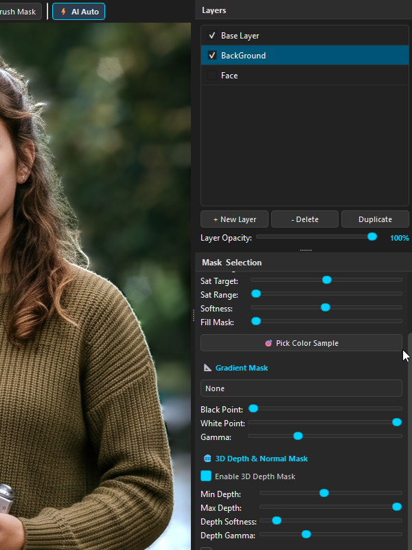

---

## 5. Built-in Adjustment Plugins

Each layer can run any combination of modular GPU-accelerated effect plugins:

### 5.1. ☀️ Basic Adjustments
- **Exposure**: Precise exposure compensation from $-3.0\text{ EV}$ to $+3.0\text{ EV}$.
- **Contrast & Gamma**: Adjust dynamic range and midtone tonal response.
- **White Balance**: Temperature (Cool $\leftrightarrow$ Warm) and Tint (Green $\leftrightarrow$ Magenta).
- **Highlights & Shadows Recovery**: Tame blown-out skies and lift deep shadow details.
- **Whites & Black Level**: Set pure white point and black clipping threshold.
- **Local Contrast & Clarity**: Enhance micro-contrast around textures and edges.
- **Global Vibrance & Chroma**: Boost color saturation in perceptual OKLCH color space.
- **Denoise (Luma & Chroma)**: Bilateral filter noise reduction in YCbCr color channels.
- **Sharpening**: High-pass detail sharpening with threshold control.
- **Vignette**: Add artistic darkening or lightening toward photo borders.

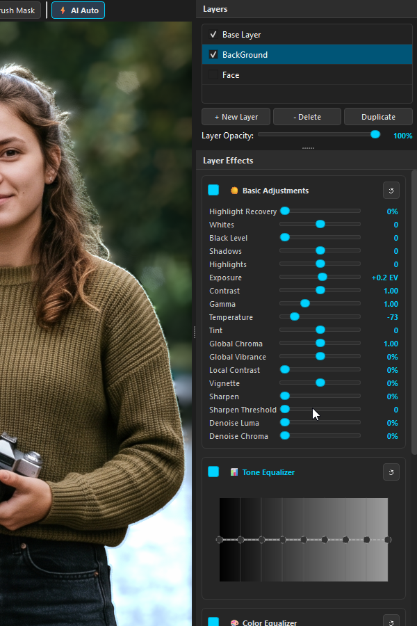

### 5.2. 📊 Tone Equalizer
- Features an interactive **8-band OKLCH curve editor**.
- Allows targeted brightening or darkening of specific luminance zones (from deep blacks at $-8\text{ EV}$ to specular highlights at $+1\text{ EV}$) without causing clipping or color shifts.

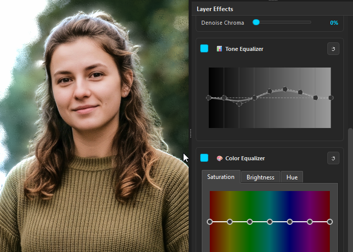

### 5.3. 🎨 Color Equalizer & 🌓 Shadow Color Equalizer
- Features an 8-band hue-based equalizer for selective color grading.
- Adjust Hue Shift, Saturation Scale, and Lightness Offset independently across 8 color ranges (Reds, Oranges, Yellows, Greens, Cyans, Blues, Purples, Magentas).
- **Shadow Color Equalizer**: Specialized 8-band color equalizer that only applies inside the shadow and mid-shadow regions, allowing cinematic split-toning and shadow tinting.

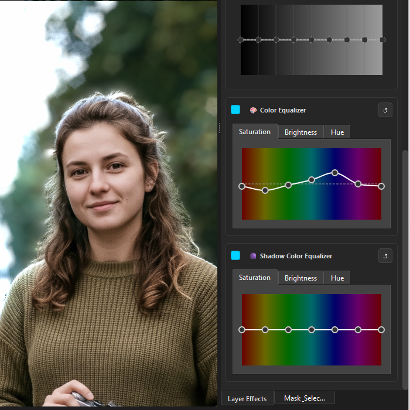

---

## 6. Precision Masking System

Control exactly where each adjustment layer takes effect:

### 6.1. 🖌️ GPU Brush Painting
1. Select a layer and activate the **`🖌 Brush`** tool (`B`) on the toolbar.
2. Adjust **Brush Size**, **Edge Hardness**, and **Opacity** in the brush settings bar.
3. **Draw on Canvas**: Left-click and drag to paint the mask. Lumens Deep features GPU sub-pixel stroke interpolation for smooth, uninterrupted lines during fast mouse sweeps.
4. **Erase Mode**: Hold **Right Click** or check the `Erase` option to erase parts of the mask.
5. **Blur Mask**: Soften hard mask boundaries under the cursor.

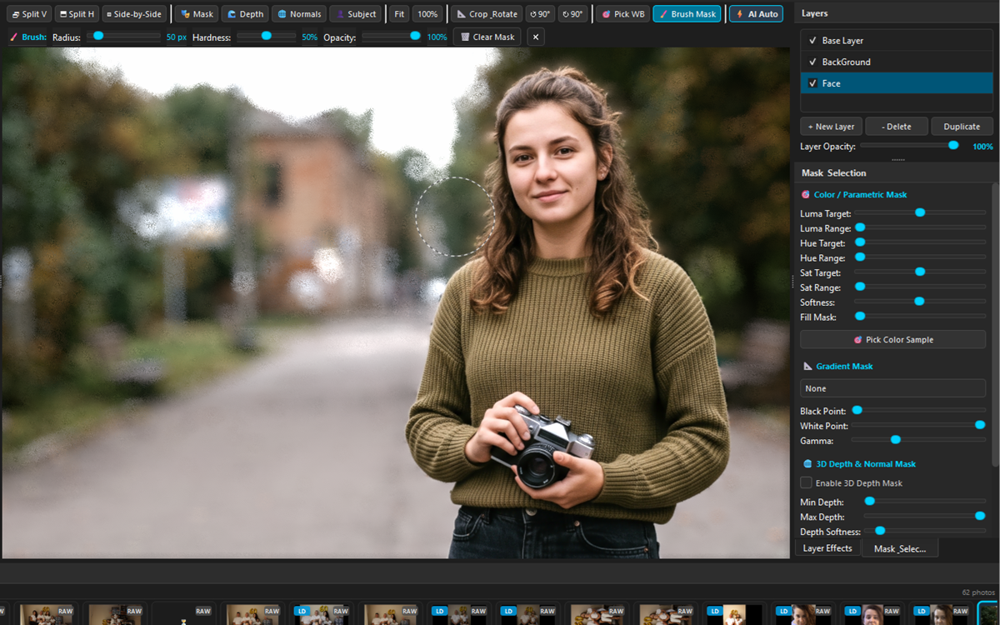

### 6.2. 🎯 Parametric Color & Luminance Masking
- **Color Range (OKLCH Hue)**: Pick or select target hues to isolate specific colors (e.g. skin tones, sky, foliage).
- **Saturation Range**: Filter by color saturation.
- **Luminance Range**: Target specific brightness levels.
- **Softness**: Adjust smooth transition falloff.

### 6.3. 📐 Gradient Masks
- Types: Linear (Left-to-Right, Right-to-Left, Top-to-Bottom, Bottom-to-Top) and Radial.
- Black Point, White Point, and Midtone Gamma controls.

### 6.4. 🧊 3D Geometric Masking
- **Depth Mask**: Isolate foreground, middle ground, or background based on estimated 3D depth intervals.
- **Surface Normal Mask**: Isolate surfaces facing specific 3D directions (e.g. surfaces facing upward for snow/dust or facing left for directional relighting).

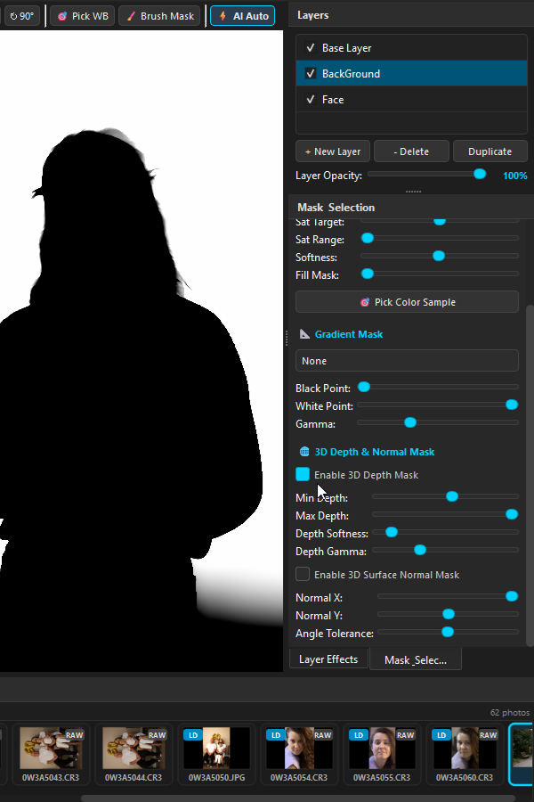

---

## 7. 🧠 Google Gemini 3.7 Flash AI Assistant

Lumens Deep integrates **Google Gemini 3.7 Flash** with extended multimodal Thinking Reasoning as an intelligent co-pilot for automated photo development and prompt-guided editing:

### 7.1. 📋 Auto-Correction Rules & Directives (Persistent Guidelines)
- Located at the top of the AI Assistant Dock.
- Contains persistent fine-art retouching guidelines used during full auto-correction passes and batch AI processing (e.g. prioritizing 3D facial contours, rich base curves, warm healthy skin tones, and background separation).
- Click **`↺ Reset`** at any time to restore default studio retouching directives.

### 7.2. 💬 One-Time AI Action / Custom Prompt (Single-Use Directive)
- Located at the bottom of the AI Assistant Dock.
- Allows sending direct, one-time instructions to Gemini without contaminating standard auto-correction rules (e.g. *"Focus on the child's face"*, *"Make skin tones warmer and peachier"*, *"Increase chiaroscuro 3D contrast"*, *"Blur background bokeh"*).
- **Hotkeys & Features**:
  - Press **`Enter`** (or click **`🚀 Send Prompt`**) to immediately execute the command.
  - The input field **clears automatically** after sending, ensuring subsequent automatic passes remain clean.
  - Press **`Shift + Enter`** to insert a newline.
  - **Quick Preset Suggestion Chips**: One-click chips (`🎯 Focus on Face`, `🌊 Blur Background`, `🍑 Warm Skin`, `🌟 3D Volume`) for instant execution.

### 7.3. ⚡ Iterative Multi-Pass Auto-Correction & Dampened Convergence
- Click **`⚡ Run Gemini Auto-Correction`** (or press `Ctrl + Shift + G`).
- Evaluates the live 32-bit floating-point canvas, dynamic range, skin tones, contrast, and composition.
- **Thinking Budget**: Configurable reasoning tokens ($1024$ to $4096$) allow Gemini to deeply reason before suggesting adjustments.
- **50% Dampened Convergence**: Refinement passes move sliders by $50\%$ towards suggested adjustments, guaranteeing smooth convergence over multi-pass iterations.
- **Automated Straighten & Balanced Compositional Crop**: Gemini inspects horizons, subject anatomy, and direction of gaze:
  * **Strict Anatomy Integrity**: Never crops through the child's hands, arms, wrists, fingers, or feet.
  * **Lead Room & Direction of Gaze**: Leaves significantly more breathing room on the side the subject is looking towards (e.g. if child looks left, preserves left margin and crops right margin).
  * **Vertical Balance & Furniture Crop**: Levels tilted lines (`straighten`), preserves comfortable headroom (`crop_top: 0-5%`), and crops redundant empty bottom cushions/furniture (`crop_bottom: 10-25%`) to place eyes along the golden upper third.

### 7.4. 🛡️ Automated AI Bokeh A/B Verification Pass
- When 3D Bokeh simulation is enabled during auto-correction, Lumens Deep performs an automated verification pass at the end of the tuning sequence.
- Gemini receives both the with-bokeh and without-bokeh rendered frames, verifies subject sharpness, and automatically disables bokeh if the subject's face was inadvertently blurred.

### 7.5. 💾 Batch AI Auto-Export (Automatic Export on Batch Tuning)
- When running **`⚡ Batch AI Auto-Correct (Filmstrip)`** or **`🚀 Full Auto: Cull + Auto-Correct All`**, enable **`💾 Auto-Export each photo on AI complete`** in the AI Assistant Dock.
- Each photo is automatically rendered in full resolution and exported to JPEG (85% quality, sRGB) immediately upon completion of its multi-pass AI auto-correction sequence.
- **Default Destination**: Saved into the `LDExport` subfolder inside the photo's folder (e.g. `<Photo_Folder>/LDExport/<filename>_edited.jpg`).
- **Custom Destination**: Click **`📁`** in the AI Dock to select any custom export directory on disk, or click **`↺`** to revert to the default `LDExport` subfolder.

---

## 8. 🎯 2-Phase AI Batch Photo Culling Engine

Quickly cull and rate hundreds of photos from a shoot using the automated 2-phase pipeline (`Ctrl + Shift + C`):

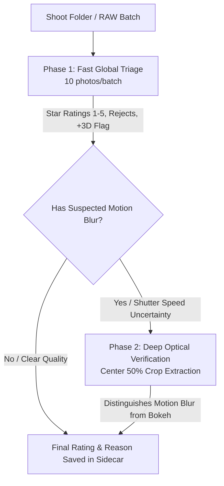

### 8.1. 🎯 2-Phase Culling & Verification Workflow
1. **Phase 1: Quick Global Triage**:
   - Evaluates batches of 10 photos simultaneously for composition, framing, lighting, subject clarity, and emotional expression.
   - Assigns Star Ratings ($1$ to $5$), flags rejects (`❌`), and proactively recommends 3D Depth Map generation (`🧊 +3D`) for keeper portraits.
2. **Phase 2: Deep Optical Crop Verification**:
   - Automatically extracts a high-resolution **Center 50% Crop** for photos with suspected motion blur or low shutter speed artifacts.
   - Accurately differentiates between **genuine motion blur** (which degrades the subject) and **intentional artistic shallow depth of field (DoF)** or soft background bokeh.
   - Writes specific, non-destructive explanations to the photo's notes (e.g. *"Why 3 stars instead of 4: slight motion blur on subject eyes [Center 50% Verified]"*).
   - Never penalizes fixable RAW properties (exposure or white balance) since they are easily corrected in post-processing.

### 8.2. ⚡ Batch AI Auto-Correction & 1-Click Full Auto Workflow
- **Run Batch AI Auto-Correction (`Ctrl+Shift+A`)**:
  - Automatically iterates through selected photos in Filmstrip (or all visible keepers).
  - If Fast Viewer is active, automatically turns it off to engage the full 32-bit RAW engine.
  - Automatically creates 3D Depth Maps and Background Layers if photos are marked with `+3D`.
  - Executes multi-pass Gemini iterative grading, curve correction, and multi-crop composition presets.
- **1-Click Full Auto Workflow (`Ctrl+Shift+F`)**:
  - Combines 2-Phase AI Photo Culling, motion-blur rejection, keeper rating, 3D depth estimation, and batch AI color grading into a single automated pipeline.
- **⏩ Skip Already Processed (Smart Resume & Fast Export)**:
  - Enabled by default in the AI dock (`chk_batch_skip_already_processed`).
  - **Already Processed & Exported**: Instantly skipped in ~40ms without reloading RAW or calling Gemini.
  - **Tuned but Missing Export**: Fast-exports missing JPEG variants in ~150ms from saved `.lumendeep` state without re-running AI passes.
- **🔄 Resilient 10-Second Persistent Retry Loop**:
  - If a Gemini API rate limit (`429 Resource Exhausted`), server hiccup (`503`), or network disconnect occurs, Lumens Deep **never skips or drops photos**.
  - Pauses for 10 seconds and automatically retries the current pass continuously until successful.
  - Press `Escape` or click **⏹ Stop** at any time to cleanly stop batch processing.
- **📷 Lensfun Optical Undistortion on 3D Neural Maps**:
  - Optical lens correction (`chk_batch_lens_correction`) is enforced across all passes.
  - Geometric undistortion (Mode 2) is automatically applied in real time to Depth Maps, Normal Maps, and Subject Masks, ensuring 100% pixel-perfect alignment and zero ghosting/doubling in 3D Bokeh and layer masks.

---

## 9. 🔇 AI Neural Noise Reduction (NAFNet In-Memory)

Lumens Deep features an integrated deep-learning noise reduction engine powered by **NAFNet (Nonlinear Activation Free Network)**, pre-trained on the real-world **SIDD (Smartphone Image Denoising Dataset)** benchmark. Unlike traditional post-ISP noise filters that blur demosaiced RGB pixels, Lumens Deep's AI Denoiser operates **in-memory directly on 32-bit linear floating-point sensor data** before tone mapping and color grading.

### Visual Comparison: RAW Sensor Noise vs. AI In-Memory Denoise

| Original High-ISO Capture (Noisy RAW) | Lumens Deep NAFNet Denoised (Clean & Sharp) |
| :---: | :---: |
|  | 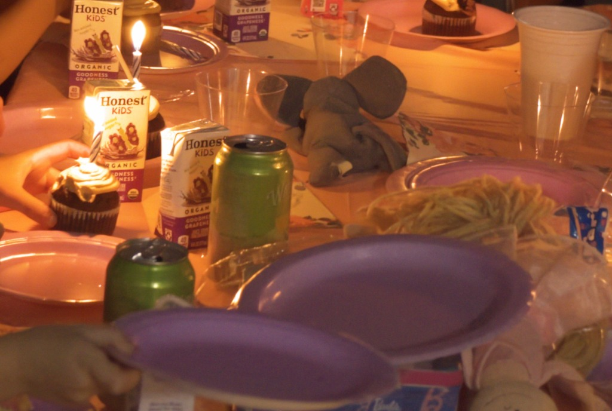 |
| *Original high-ISO capture with prominent photon shot noise and chrominance grain.* | *In-memory NAFNet neural restoration with 100% noise removal and crisp micro-texture retention.* |

### 9.1. Interactive Controls in the AI Assistant Dock
Under the **AI Noise Reduction (NAFNET In-Memory)** card in the AI Assistant Dock:
- **`🔇 AI Denoise Current Photo (In-Memory)`**: One-click button to execute neural denoising on the currently active photo. Denoised linear pixels update GPU textures in real time with zero disk bottleneck.
- **Strength Slider (`0% - 100%`, default: `100%`)**: Blends between original linear sensor data and neural denoised output.
- **Texture / Detail Retention Slider (`0% - 100%`, default: `25%`)**: Re-injects high-frequency organic micro-textures and film grain via spatial frequency coring, ensuring portrait skin and fabrics never look artificial or plastic.
- **Tile Size (`512` / `1024`, default: `512`)**: Controls spatial patch partitioning with 2D cosine window blending for 100% seamless output without grid lines.
- **Model Architecture**:
  - `NAFNet-SIDD-width64.pth` (Default, Highest Quality: 40.30 dB PSNR)
  - `NAFNet-SIDD-width32.pth` (Lightweight, Ultra-Fast for low-VRAM GPUs)
- **`[x] Save Denoised 16-bit Linear TIFF`**: Optionally saves a lossless 16-bit linear TIFF into `{folder}/LumenDeep/` for external VFX workflows.

### 9.2. Automated ISO-Threshold Gating during Batch AI & Fast Export
- **`[x] Auto-Denoise before export when ISO > [200]`**:
  - When enabled, Lumens Deep inspects camera sensor ISO metadata (`raw.other.iso_speed`, EXIF 2.3+ `PhotographicSensitivity`).
  - If a photo's ISO exceeds the user-configured threshold (default: `200`), NAFNet In-Memory Denoise executes automatically before rendering and saving export JPEGs.
  - Fully integrated into **`⚡ Batch AI Auto-Correct (Filmstrip)`**, **`🚀 Full Auto`**, and **`⏩ Skip already processed (Resume & Export missing)`**.
  - Tuned photos with saved `.lumendeep` project sidecars are automatically denoised in-memory and re-exported with clean, noise-free output without re-running Gemini AI prompts.

### 9.3. Live Before/After Split Comparison (`Split V`, `Split H`, `Side-by-Side`)
- After running AI Denoise, Lumens Deep preserves the original noisy sensor capture as `self.engine.source_texture`.
- Pressing **`V`** (Vertical Split Wipe), **`H`** (Horizontal Split Wipe), or **`B`** (Side-by-Side View) displays the pre-denoised RAW source on one side and the clean denoised composite on the other side, allowing instantaneous inspection of fine details.

---

## 10. 🧊 3D Neural Maps & Cinematic Bokeh Simulation

### 10.1. Generating Neural 3D Maps
Under the **`AI & 3D Tools`** menu or the **AI Assistant Dock**:
- **Compute Depth Map (`Ctrl+Shift+D`)**: Generates 16-bit high-resolution metric depth map via Marigold.
- **Compute Normal Map (`Ctrl+Shift+N`)**: Generates surface normal vectors for 3D relighting.
- **Compute Subject Mask (`Ctrl+Shift+S`)**: Extracts hair-level subject foreground segmentation.

### 10.2. ✨ 3D Bokeh Simulation & Interactive Focus Picker
Transform flat photos into shallow depth-of-field captures with cinematic optical simulation:
- **Enable Bokeh Simulation**: Activates progressive Monte Carlo depth-of-field raymarching across 3D metric depth maps.
- **🎯 Interactive 3D Focus Picker Eyedropper**:
  - Click **`🎯 Pick 3D focal Depth point from photo on canvas`** (or the target icon beside Focal Distance).
  - Click directly on the subject's eye, face, or any object on the canvas.
  - Lumens Deep samples the exact 3D depth at those image coordinates and instantly sets the focal plane.
- **Focal Distance (Depth)**: Shift focus interactively from foreground ($0\%$, Near) to background ($100\%$, Far).
- **Focal Range**: Adjusts the thickness of the in-focus plane (Depth of Field). Recommended $20-35\%$ on portraits to ensure the entire subject stays tack-sharp.
- **Max Radius (Aperture / Blur Disc Size)**: Directly controls the physical lens aperture opening ($f$-stop) and background blur strength:
  - `0 - 10`: Closed aperture / pinhole ($f/16 - f/11$, deep depth of field, sharp background).
  - `15 - 25`: Subtle optical separation ($f/4.0 - f/2.8$, gentle portrait softening).
  - `35 - 50`: Fast prime portrait lens wide open ($f/1.8 - f/1.4$, creamy background blur and luminous bokeh circles).
  - `60 - 80+`: Ultra-fast $85\text{mm } f/1.2$ or $135\text{mm } f/1.8$ medium-format look (extreme painterly background obliteration).
- **Subject Influence**: Recommended to keep at $0\%$ on initial attempts for organic optical blur roll-off without cutout artifacts.
- **Aperture Blades**: Configurable from 3 blades (Triangle), 4 blades (Square) up to 10 blades (Circular smooth lens).
- **Optical Vignette (Cat-Eye)**: Simulates realistic lens pupil truncation towards frame corners.
- **Chromatic Aberration**: Adds radial color fringing in out-of-focus highlights.
- **Highlight Boost**: Amplifies bokeh balls in specular regions.

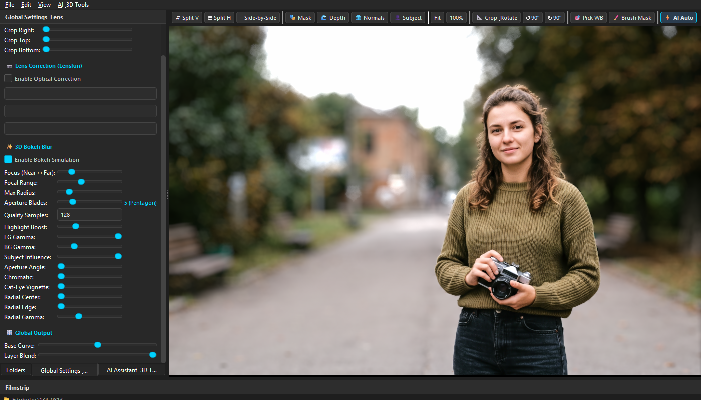

### 10.3. ⚡ AI Hardware Acceleration & GPU Configuration

Lumens Deep features an adaptive, heterogeneous inference engine designed to maximize GPU speed while maintaining 100% crash-free stability across all hardware architectures.

#### 1. Hardware Backends Supported
- **NVIDIA CUDA FP16 (Highest Performance)**: Uses Tensor Cores on NVIDIA RTX/GTX GPUs with batched patch inference (e.g. RTX 4070 processes 518x518 patches in **0.024s** each, ~12x faster than CPU).
- **DirectML (DirectX 12)**: Provides hardware acceleration for AMD Radeon, Intel Arc, and Intel UHD/Iris GPUs on Windows.
- **CoreML / Metal**: Hardware acceleration for Apple Silicon (M1/M2/M3/M4) on macOS.
- **PyTorch Multi-Threaded CPU**: Resilient multi-core fallback on systems without dedicated GPUs.

#### 2. AI Hardware Settings in the AI Assistant Dock
Located in the **AI Assistant & 3D Tools** dock panel:
- **Device Badge**: Displays detected GPU model and dedicated VRAM (e.g. `🎮 Device: NVIDIA GeForce RTX 4070 Laptop GPU (8.0 GB VRAM)`).
- **Acceleration Engine Selector**:
  - `Auto (Optimal Performance)`: Automatically chooses the fastest available backend (TensorRT / CUDA $\rightarrow$ DirectML $\rightarrow$ CPU).
  - `NVIDIA CUDA / TensorRT`: Forces NVIDIA CUDA FP16 mode.
  - `DirectML (DirectX 12 / AMD / Intel)`: Forces Windows DirectX 12 hardware acceleration.
  - `CPU Safe Mode (Force CPU)`: Forces multi-threaded CPU execution.
- **🛡️ Disable GPU (Safe Mode / CPU Only) Checkbox**:
  - Instantly cuts off GPU memory allocation and switches the engine to CPU-only execution.
  - **When to use**: If running into GPU driver timeouts (TDR), low VRAM on 2GB/4GB cards, or heavy 3D rendering in other software.
  - Settings are automatically saved to `.env` (`AI_HARDWARE_MODE`, `AI_DISABLE_GPU`) and persist across sessions.

#### 3. Dynamic Crash Shield & OOM Auto-Recovery
If a GPU runs out of VRAM (`torch.cuda.OutOfMemoryError`) or encounters a driver timeout during high-resolution Laplacian PatchFusion tiling:
1. Lumens Deep catches the exception cleanly without crashing or closing the application.
2. Purges GPU cache and releases device handles (`torch.cuda.empty_cache()`, `gc.collect()`).
3. Automatically falls back to CPU Safe Mode and completes the current tile/image seamlessly.

---

## 11. 🔌 Model Context Protocol (MCP) Server

Lumens Deep includes a built-in **FastMCP Server** (`src/mcp_server.py`) enabling external AI coding assistants and agents to interact directly with the running photo editor:
- **Transport**: Standard I/O and SSE (Server-Sent Events) on `http://localhost:8000/sse`.
- **Tools**:
  - `get_editor_state()`: Returns current layer stack, active parameters, and metadata.
  - `apply_adjustments(state)`: Applies non-destructive adjustments to the live GPU canvas.
  - `get_viewport_image(max_size)`: Captures live rendered viewport image for multimodal reasoning.
  - `get_image_crop(center_x, center_y, width, height)`: Extracts full-resolution sub-pixel crops.
  - `get_histogram_stats()`: Computes 32-bit linear RGB luminance and channel distributions.

---

## 12. 💾 Exporting & Sidecar Saving

- **Save Project / Sidecar (`Ctrl+S`)**: Saves all layers, masks, curve points, crop geometry, notes, and plugin settings to a JSON sidecar file (`.lumendeep`) inside `{folder}/LumenDeep/`.
- **Export Image (`Ctrl+E`)**: Renders full-resolution image to 16-bit TIFF, PNG, or high-quality JPEG with all non-destructive adjustments applied.

### 12.1. 📁 Aspect Ratio Subfolder Auto-Sorting & 5-Star Curation
When batch exporting (via Batch AI Auto-Export or right-clicking in Filmstrip -> **"Batch Export to JPEG 85%"**), Lumens Deep automatically categorizes and slices all images and multi-crop presets into dedicated aspect ratio subfolders:

- 🖼️ **`./LDExport/Original/`**: Full-frame uncropped master images.
- 📱 **`./LDExport/Photo_iPad_4x5/`**: 4:5 vertical and 5:4 horizontal crops (Instagram portrait / iPad).
- 🎞️ **`./LDExport/Portrait_2x3/`**: 2:3 vertical and 3:2 horizontal classic 35mm crops.
- ⏹️ **`./LDExport/Square_1x1/`**: 1:1 square compositions (avatars / feeds).
- 📐 **`./LDExport/Story_3x4/`**: 3:4 vertical and 4:3 horizontal stories.
- 🎬 **`./LDExport/Cinematic_16x9/`**: 16:9 widescreen and 9:16 vertical video formats.

#### ⭐ The 5-Star Rule for Effortless Client Delivery:
- **5★ Top Picks**: Automatically save an **additional master copy directly in the root `./LDExport/` folder** for immediate delivery to clients.
- **4★ and Lower**: Saved strictly inside their respective aspect subfolders, keeping the root folder clean and reserved only for top highlights.
- **Dual Bokeh Export**: If enabled, exports both the clean edit and the 3D Bokeh version (`_bokeh.jpg`).

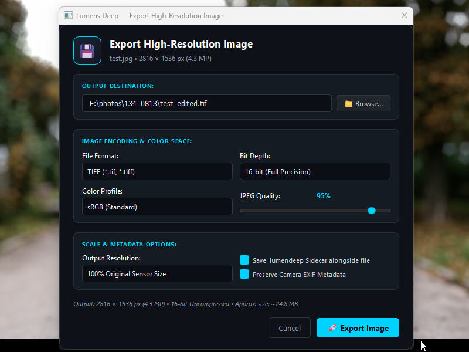

---

## 13. ⌨️ Keyboard Shortcuts Summary

| Shortcut | Action |
| :--- | :--- |
| `Ctrl + O` | Open Image or RAW file |
| `Ctrl + S` | Save Adjustments / Sidecar (`.lumendeep`) |
| `Ctrl + E` | Export Processed Image (16-bit TIFF / PNG / JPEG) |
| `Ctrl + 0` | Fit to Viewport |
| `Ctrl + 1` | Zoom to 100% (1:1 View) |
| `Ctrl + +` / `Ctrl + -` | Zoom In / Zoom Out |
| `Ctrl + Z` / `Ctrl + Y` | Undo / Redo |
| `Ctrl + Shift + G` | Run Gemini AI Auto-Correction |
| `Ctrl + Shift + A` | Run Batch AI Auto-Correction on Filmstrip |
| `Ctrl + Shift + F` | Run Full Auto Workflow (Cull + AI Auto-Correct) |
| `Ctrl + Shift + C` | Launch 2-Phase AI Batch Photo Culling |
| `Ctrl + Shift + D` | Compute AI Depth Map (Marigold) |
| `Ctrl + Shift + N` | Compute AI Surface Normal Map |
| `Ctrl + Shift + S` | Compute AI Subject Mask |
| `V` | Toggle Fast Viewer Mode (Instant Browse) |
| `Escape` | Stop AI / Batch Auto-Correction |
| `1` – `5` | Set Star Rating (1 to 5 Stars) |
| `0` | Clear Star Rating |
| `X` | Mark for Deletion (Reject `❌`) |
| `Left / Right Arrow` | Navigate Previous / Next Photo in Filmstrip |
| `D` | Toggle Depth Map Visualizer |
| `N` | Toggle Normal Map Visualizer |
| `S` | Toggle Subject Mask Visualizer |
| `M` | Toggle Layer Mask Overlay |
| `B` | Toggle Brush Mask Painting Tool |
| `C` | Toggle Interactive Crop & Straighten |
| `\` | Toggle Before / After View |
